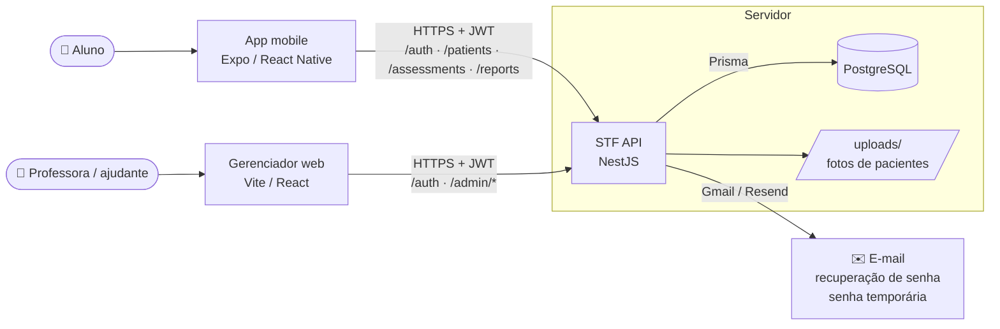

# STF API — Sênior Teste Funcional

API **NestJS + Prisma + PostgreSQL** do **Sênior Teste Funcional (STF)**, sistema de avaliação funcional de pacientes idosos usado na clínica-escola de fisioterapia. Os alunos aplicam testes padronizados pelo app, a professora supervisiona tudo pelo painel web, e **esta API é o centro**: guarda os dados, calcula os resultados clínicos e gera os relatórios em PDF.

| Repositório | Link |
|-------------|------|
| **STF API** (este) | [github.com/Alancfops/senior-test-api](https://github.com/Alancfops/senior-test-api) |
| App mobile | [github.com/Alancfops/senior-test-funcional](https://github.com/Alancfops/senior-test-funcional) |
| Gerenciador web | [github.com/Alancfops/senior-test-web](https://github.com/Alancfops/senior-test-web) |

---

## Sumário

1. [O projeto](#o-projeto)
2. [Arquitetura](#arquitetura)
3. [Rotas da API](#rotas-da-api)
4. [Como rodar](#como-rodar)
5. [Configuração](#configuração)
6. [Comandos](#comandos)
7. [Testes](#testes)
8. [Documentação](#documentação)

---

## O projeto

O STF digitaliza cinco instrumentos clínicos usados na avaliação funcional de idosos:

| Instrumento | Avalia |
|-------------|--------|
| **TUG** (Timed Up and Go) | Mobilidade e risco de quedas (tempo em segundos, 3 ensaios) |
| **Katz** | Independência nas atividades básicas de vida diária |
| **Berg** | Equilíbrio (14 itens, 0–56 pontos) |
| **Tinetti** | Equilíbrio e marcha (0–28 pontos) |
| **MEEM** (Miniexame do Estado Mental) | Rastreio cognitivo, com corte por escolaridade |

O ecossistema tem três sistemas, em três repositórios clonados lado a lado:

| Sistema | Quem usa | O que faz |
|---------|----------|-----------|
| **STF API** (este repo) | Os dois clientes abaixo | Contas e login (JWT), pacientes, avaliações, **cálculo de pontuação e classificação**, geração de PDF, e-mails, permissões e trilha de auditoria |
| **App mobile** | Fisioterapeutas (alunos) — papel `THERAPIST` | Cadastrar pacientes, aplicar os testes, ver histórico, gráfico e PDF. Cada aluno só vê os próprios pacientes |
| **Gerenciador web** | Professora (`ADMIN`) e ajudantes (`ASSISTANT`) | Supervisão de toda a equipe pelas rotas `/admin/*`: transferir/excluir, aprovar ajudantes, relatórios individuais e geral, auditoria |

> **Princípio central:** toda regra clínica — pontuação, interpretação e PDF — vive **só nesta API**. Os clientes coletam respostas e exibem o que a API devolve; nenhum duplica cálculo. Uma correção clínica feita aqui vale para o app e para o painel ao mesmo tempo.

### Papéis

| Papel | Onde entra | Permissões |
|-------|-----------|------------|
| `THERAPIST` (aluno) | App | Apenas os próprios pacientes e avaliações |
| `ASSISTANT` (ajudante) | App + painel | No painel, supervisiona a equipe; não gerencia ajudantes |
| `ADMIN` (professora) | App + painel | Visão de toda a equipe; conta única, definida só pelo script `admin:set` |

---

## Arquitetura

### Arquitetura do sistema



### Módulos da API

| Módulo | Responsabilidade |
|--------|------------------|
| `AuthModule` | Login, cadastro, recuperação e troca de senha (JWT) |
| `PatientsModule` | Pacientes do fisioterapeuta logado |
| `AssessmentsModule` | Avaliações: rascunho → finalização, com cálculo do resultado |
| `ReportsModule` | PDF por avaliação e relatório geral |
| `AdminModule` | Rotas `/admin/*` do painel, protegidas pelo `AdminGuard` |
| `NotificationsModule` | Envio de e-mails |
| `PrismaModule` | Acesso ao PostgreSQL |

Cada instrumento é um *handler* isolado em `src/assessments/instruments/<código>/`, com schema Zod do payload, cálculo da pontuação e classificação. O `registry.ts` liga o código do instrumento ao handler.

---

## Rotas da API

Documentação interativa (dev): **[http://localhost:3000/api/docs](http://localhost:3000/api/docs)** (Swagger).

| Grupo | Rotas | Usado por |
|-------|-------|-----------|
| Autenticação | `POST /auth/login` · `/register` · `/forgot-password` · `/verify-reset-code` · `/reset-password` · `/change-password` · `/admin-access-request` | App e painel |
| Pacientes | `GET/POST /patients` · `GET/PATCH /patients/:id` · histórico `/patients/:id/assessments[/:assessmentId]` · gráfico `/patients/:id/instruments/:code/timeseries` | App |
| Avaliações | `POST /assessments/draft` · `PATCH /assessments/:id` · `POST /assessments/:id/finalize` · `GET /assessments/recent` | App |
| Relatórios | `POST /reports/assessments/:assessmentId` | App |
| Painel | `GET /admin/therapists[/:id]` · `GET/DELETE /admin/patients/:id` · `POST /admin/patients/:id/transfer` · `DELETE /admin/therapists/:id` · `/admin/access-requests` (+ approve/reject) · `POST /admin/assistants/:id/revoke` · `POST /admin/reports/assessments/:id` · `POST /admin/reports/general` · `GET /admin/audit-logs` | Painel |
| Outros | `GET /instruments` · `GET /health` | Catálogo / monitoramento |

Rotas `/admin/*` exigem papel `ADMIN` ou `ASSISTANT` (`AdminGuard`); as demais filtram sempre pelo fisioterapeuta do token.

---

## Como rodar

Pré-requisitos: **Node.js 20+**, **Docker** (Postgres) e **make**.

```bash
git clone git@github.com:Alancfops/senior-test-api.git stf-api
cd stf-api

make setup      # primeira vez: deps, .env, Postgres
make migrate    # migrations Prisma
make start      # Postgres + API em watch (http://localhost:3000)

# conta da professora (ADMIN) — senha temporária enviada por e-mail
npm run admin:set -- --email professora@exemplo.com --name "Profa. Fulana"
```

Verificação: `curl http://localhost:3000/health` · Swagger em `/api/docs`.

Com a API no ar, suba os clientes nos repositórios deles: `make start-frontend` no app e `npm run dev` no gerenciador.

---

## Configuração

`make setup` cria o `.env` a partir de `.env.example`:

| Variável | Uso |
|----------|-----|
| `DATABASE_URL` | PostgreSQL (Docker: `senior:senior@localhost:5432/senior_test`) |
| `JWT_ACCESS_SECRET` | Segredo JWT (mín. 32 caracteres) — gere com `make secrets` |
| `MAIL_PROVIDER` | `gmail`, `console` (código no terminal) ou `resend` |
| `CORS_ORIGINS` | Origens do gerenciador web (ex.: `http://localhost:5173`) |

Teste o envio de e-mail: `make mail-check`.

---

## Comandos

| Comando | Descrição |
|---------|-----------|
| `make start` | Postgres + API em watch |
| `make db-up` / `make db-down` | Sobe / para o Postgres |
| `make migrate` / `make generate` | `prisma migrate dev` / `prisma generate` |
| `make test` | Unitários + e2e |
| `make lint` | ESLint |
| `npm run admin:set -- --email <e-mail> --name "<nome>"` | Define a professora (primeira vez ou conta do app existente) |
| `npm run admin:set -- --email <e-mail>` | Recupera o acesso (nova senha temporária) |
| `npm run admin:set -- --email <novo> --name "<nome>" --replace` | Troca a professora — a atual vira ajudante |

---

## Testes

| Tipo | Comando | Cobre |
|------|---------|-------|
| Unitários | `npm test` | Pontuação e classificação de cada instrumento, montagem dos PDFs, e-mail |
| End-to-end | `npm run test:e2e:prepare && npm run test:e2e` | API real contra o banco isolado `senior_test_e2e`: login, pacientes, avaliações, rotas admin, relatórios |

O banco de testes é separado — rodar o e2e **não** toca nos dados de desenvolvimento.

---

## Documentação

| Tema | Onde |
|------|------|
| Comportamento da API (RFs) | [docs/backend/README.md](docs/backend/README.md) |
| Modelo de dados | [docs/engineering/data-model.md](docs/engineering/data-model.md) |
| Regras do backend | [docs/rules/](docs/rules/) |
| Protocolos clínicos (TUG, Katz, Berg, Tinetti, MEEM) | [senior-test-funcional/docs/clinical-protocols](https://github.com/Alancfops/senior-test-funcional/tree/main/docs/clinical-protocols) |
| Requisitos e LGPD | [senior-test-funcional/docs/product](https://github.com/Alancfops/senior-test-funcional/tree/main/docs/product) |
| Contrato do painel (`/admin/*`) | [senior-test-web/docs/contracts/admin-api.md](https://github.com/Alancfops/senior-test-web/blob/main/docs/contracts/admin-api.md) |
